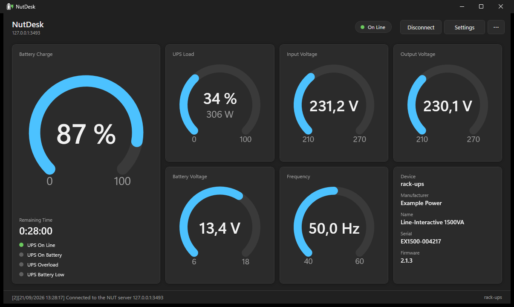
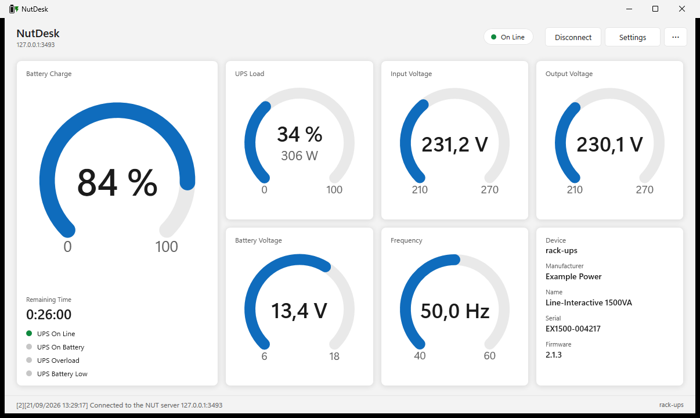
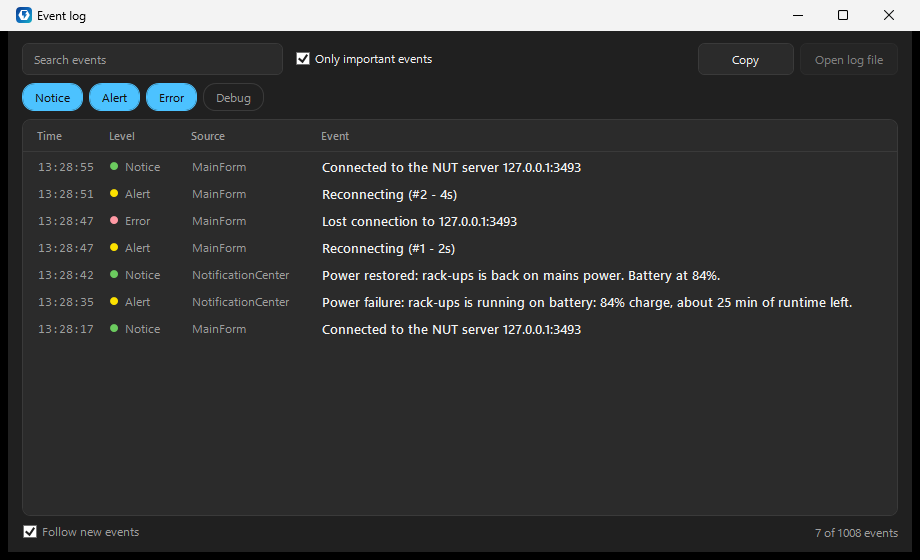
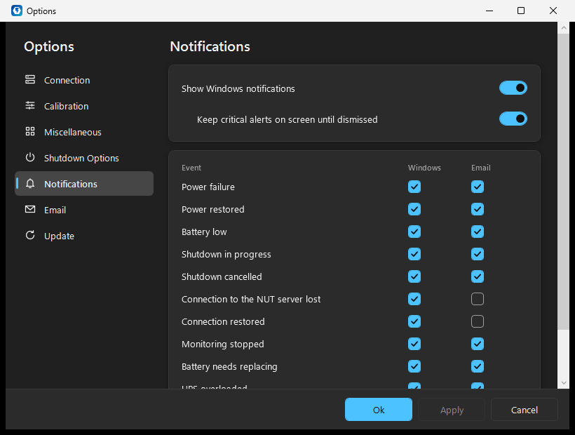
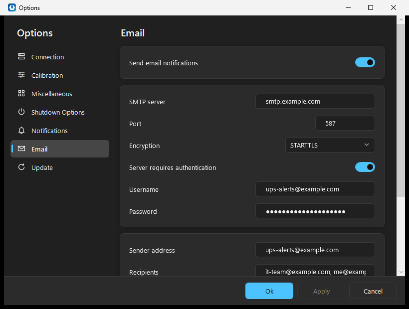

<p align="center">
  
</p>

<h1 align="center">NutDesk [AwardTech]</h1>

<p align="center">
  A Windows desktop client for <a href="https://networkupstools.org/">Network UPS Tools</a>.<br>
  Watch your UPS, get told when the power goes, and shut down safely before the battery runs out.
</p>

<p align="center">
  <a href="https://github.com/AwardTech/NutDesk/releases/latest"></a>
  <a href="https://github.com/AwardTech/NutDesk/actions/workflows/build.yml"></a>
  <a href="LICENSE"></a>
</p>

---

## What NutDesk is

NutDesk [AwardTech] is the AwardTech-maintained fork of NutDesk. It connects to a NUT server (`upsd`) - on a Linux box, a Synology or QNAP NAS, a Raspberry Pi, or anywhere
else NUT runs - and monitors the UPS it manages. It shows the state of the UPS at a glance, tells you through
Windows notifications and email when something happens, and shuts down, suspends or hibernates the computer when
the battery gets too low or when the server asks every client to go down.

- **Dashboard** with ring gauges for battery charge, load, input and output voltage, battery voltage and
  frequency, a status badge, and connect / disconnect / settings commands in the header.
- **Light, dark or follow-Windows theme**, chosen from the application menu.
- **Windows notifications** for 11 events, with critical alerts that stay on screen until you dismiss them.
- **Email notifications** over SMTP, with an outbox that survives network outages and restarts.
- **Automatic shutdown** on battery charge or runtime limits, or on a forced shutdown (FSD) from the server.
- **Event log window** with severity filters, search and an "important events" view.
- **Automatic reconnection** when the NUT server restarts or the network drops.
- **UPS Commands** with battery-test, beeper and power controls, server-reported beeper status, and a list of commands advertised by the connected NUT server.
- **Unsupported-variable detection** that remembers variables the UPS does not provide and lets you clear the list to rediscover capabilities.
- **Updates from within the app**: new versions are found on GitHub, checked against their published SHA-256
  and installed in place, with an automatic restart.
- **Portable**: no installer, no administrator rights; unzip and run.
- **Translated** into English, Italian, German, French, Russian, Ukrainian and Chinese.

## Screenshots

| Dark theme | Light theme |
|---|---|
|  |  |

| Event log | Notification preferences | Email preferences |
|---|---|---|
|  |  |  |

## Requirements

- Windows 10 or Windows 11.
- .NET Framework 4.8. It is already part of Windows 10 version 1903 and later and of Windows 11; on older builds of
  Windows 10, install it from Microsoft.
- A reachable NUT server. NutDesk is a NUT *client*: the UPS itself is connected to the server, not to this PC.

Windows notifications need Windows 10 or later.

## Installation

1. Download `NutDesk-<version>-portable.zip` from the
   [Releases](https://github.com/AwardTech/NutDesk/releases/latest) page.
2. Extract it anywhere you like - for example `C:\Tools\NutDesk` or a USB stick.
3. Run `NutDesk.exe`.

To start NutDesk with Windows, turn on **Start with Windows** under **Settings > Miscellaneous**. The entry
follows the program: if you move the NutDesk folder, start `NutDesk.exe` once from its new place and Windows will
start that copy from then on.

### Where NutDesk keeps its data

Everything NutDesk writes goes under `%LOCALAPPDATA%\NutDesk`, per Windows user, in folders that stay the same from
one version to the next, so an update finds the logs and the email outbox of the version before it:

| What | Where, under `%LOCALAPPDATA%\NutDesk` |
|---|---|
| Preferences | `NutDesk.exe_Url_<hash>\<version>\user.config`: standard .NET user settings, kept per location of `NutDesk.exe`. A new version, or a copy started from another folder, takes them over on its first start. |
| Log files | `Logs`, when **Create LogFile** is on |
| Email outbox | `Notifications\outbox.json` |
| Crash reports | `CrashReport_<date>.txt` |
| Downloaded updates | `Updates`, emptied once the update is installed |

To keep NutDesk's files next to the program instead - on a USB stick, say - start it with the
`-PersistDataInStartupPath` switch:

```
NutDesk.exe -PersistDataInStartupPath
```

Log files, the email outbox and crash reports are then written next to `NutDesk.exe` (provided that folder is
writable; otherwise NutDesk falls back to `%LOCALAPPDATA%\NutDesk`). The preferences themselves are standard
.NET user settings and always stay under `%LOCALAPPDATA%\NutDesk`, and so do downloaded updates. An update installed
from within NutDesk restarts it with the same switch.

## Updating

NutDesk looks for new versions on its [Releases](https://github.com/AwardTech/NutDesk/releases) page by itself: a
minute after it starts, then whenever the interval chosen in **Settings > Update** has passed (weekly unless you
choose daily or monthly), for as long as it runs. Turn off **Check for updates automatically** there to stop it;
with the branch set to **Development**, pre-releases are offered too. **Verify Update**, in the application menu
under **Help** and in the tray icon's menu, checks straight away and always tells you the outcome.

When there is a new version, NutDesk sends the **Update available** notification - once per version; both the
Windows notification and, once email is set up, the email are on by default in **Settings > Notifications** - and
opens the update window with the release notes:

- **Install update** downloads the portable ZIP and checks it against the SHA-256 checksum published next to it
  (`NutDesk-<version>-portable.zip.sha256`). A download that does not match is deleted, and a release without a
  checksum is not installed.
- **Install and restart** then closes NutDesk for a few seconds, replaces its files and starts the new version,
  which says that it has been updated. Preferences, logs and the email outbox carry over. Should the files not
  all be copied, the previous version is put back and started again, and it tells you why. NutDesk does not
  install while the UPS is on battery or a shutdown is under way: it would stop watching the UPS meanwhile.
- **Skip this version** stops the automatic checks from offering that version again; a check you ask for still
  shows it.
- **Release page** opens the release on GitHub.

If NutDesk cannot write to its own folder - it was put under `C:\Program Files`, say - the update window opens the
downloaded and verified new version in Explorer instead, for you to finish by hand as below.

### Updating by hand

1. Download `NutDesk-<version>-portable.zip` from the
   [Releases](https://github.com/AwardTech/NutDesk/releases/latest) page.
2. Exit NutDesk: **Exit** in the application menu or in the tray icon's menu.
3. Copy the contents of the `NutDesk-<version>` folder in the ZIP over your NutDesk folder, replacing the files.

You can also extract the new version anywhere else and run it from there: on its first start it takes over the
preferences of the copy you used before, and **Start with Windows** moves to it.

## First connection

Open **Settings** from the dashboard header and fill in the **Connection** section:

| Field | What to enter |
|---|---|
| NUT host | Name or IP address (IPv4 or IPv6) of the NUT server |
| NUT Port | `3493`, the NUT default, unless your server uses another one |
| UPS Name | The name of the UPS as configured on the server (`upsc -l` on the server lists them) |
| Login / Password | Only if the server requires them; leave empty otherwise |
| Re-establish connection | Reconnect automatically when the connection drops. Recommended. |

Then press **Connect**. With **Re-establish connection** on, NutDesk keeps trying after the server restarts or the
network drops, waiting 2 seconds at first and up to 60 seconds between attempts, without ever freezing the window.

### Synology NAS

When the UPS is attached to a Synology NAS, enable the network UPS server in DSM (**Control Panel > Hardware &
Power > UPS**) and add this PC's IP address under **Permitted DiskStation Devices**. Synology's NUT server uses
fixed credentials:

- **UPS Name**: `ups`
- **Login**: `upsmon`
- **Password**: `secret`

See the [Synology documentation](https://kb.synology.com/en-us/DSM/help/DSM/AdminCenter/system_hardware_ups?version=7)
for details.

### QNAP NAS

When the NUT server is a QNAP NAS, tick **Enable network UPS master** under **Control Panel > External Device > UPS**
in the QNAP web interface and add this PC's IP address to the list of allowed clients. Then use:

- **UPS Name**: `qnapups`
- **Login / Password**: usually empty

*The Synology and QNAP notes come from the original
[WinNUT-Client README](https://github.com/nutdotnet/WinNUT-Client) and its contributors.*

## Notifications

NutDesk can tell you about 11 events. In **Settings > Notifications** each one has two check boxes: one for a
Windows notification, one for an email.

| Event | Critical |
|---|---|
| Power failure - the UPS switched to battery | yes |
| Power restored | |
| Battery low | yes |
| Shutdown in progress | yes |
| Shutdown cancelled - power came back in time | |
| Connection to the NUT server lost | |
| Connection restored | |
| Monitoring stopped - NutDesk gave up reconnecting, or automatic reconnection is turned off | |
| Battery needs replacing | |
| UPS overloaded | |
| Update available | |

With **Keep critical alerts on screen until dismissed**, the critical notifications do not fade away on their
own, so a power failure is still on screen when you come back to the desk. Clicking a notification opens NutDesk.

### Email

Turn on **Send email notifications** in **Settings > Email** and enter your provider's SMTP details:

| Provider | SMTP server | Port | Encryption |
|---|---|---|---|
| Gmail | `smtp.gmail.com` | 587 | STARTTLS |
| Outlook.com | `smtp-mail.outlook.com` | 587 | STARTTLS |
| Aruba | `smtps.aruba.it` | 465 | SSL/TLS |

**Encryption** can be *Automatic* (SSL/TLS on port 465, STARTTLS elsewhere when the server offers it), *STARTTLS*,
*SSL/TLS* or *None*. Tick **Server requires authentication** and enter a username and password if your provider
asks for them - most do. The password is stored encrypted with Windows DPAPI, readable only by your Windows
account.

Gmail and Outlook.com do not accept your normal password here: create an **app password** in your account's
security settings (Gmail requires 2-Step Verification for that) and use it instead.

> NutDesk signs in to the SMTP server with a username and password. Microsoft is retiring this "basic"
> authentication for SMTP in Microsoft 365 (Exchange Online), so work and school Microsoft 365 mailboxes may
> refuse it. Use another provider, or an SMTP relay your organisation provides, in that case.

Press **Send test email** to check the settings before relying on them: NutDesk sends a test message straight away
and tells you whether it went through, or why not.

Some things worth knowing:

- **The outbox.** During a power cut the router is often down too. Every email is first written to an outbox on
  disk, then sent; if the network is unreachable NutDesk keeps retrying - quickly at first, then every quarter of
  an hour - and survives restarts, for up to 48 hours. An email that arrives late says when it was written and
  when it could finally be sent.
- **The cooldown.** A flapping supply can switch the UPS between mains and battery many times a minute. Repeated
  events of the same kind within **Minimum interval between repeated events** (5 minutes by default, 0 to turn
  it off) are merged into one later message that lists what happened and describes the latest state.
- **Shutdown.** Before NutDesk shuts the computer down it gives the outbox a last few seconds, so the "shutdown
  in progress" email leaves while the network is still up.

## Automatic shutdown

In **Settings > Shutdown Options**:

- **Shutdown if battery lower than** (%) and **Shutdown if runtime lower than** (seconds): while the UPS is on
  battery, reaching either limit starts the shutdown procedure.
- **Shutdown on Nut's FSD Signal**: also start it when the NUT server declares a forced shutdown (FSD), which is
  how the server tells every client to go down before it cuts the power.
- **Type of Stop**: shut down, sleep or hibernate.
- **Immediate stop action**: act at once, without a countdown.
- **Delay to Shutdown**: otherwise, a countdown window appears for this many seconds. If power comes back during
  the countdown, the shutdown is cancelled.
- **Allow Extended Shutdown Time** and **Grace Delay to Shutdown**: add a **Grace Time** button to the countdown
  window, which gives you that many extra seconds to save your work. Use it with care: the extra time can outlast
  what is left in the battery.

## Event log

**Event log** in the application menu opens a window listing the most recent events NutDesk has recorded in this session (up to 1,000).
Filter by severity (Notice, Alert, Error, Debug), search the text, or tick **Only important events** to see just
the connections, power changes and failures. **Copy** puts the events currently listed on the clipboard, and
**Open log file** opens the folder of today's log file when file logging is turned on (**Settings >
Miscellaneous > Create LogFile**).

## Languages

NutDesk follows the Windows display language. Available: English, Italian, German, French, Russian, Ukrainian,
Simplified Chinese and Traditional Chinese.

The features added in NutDesk - the dashboard, notifications, email, the event log and update windows and the new
preferences - are translated into English and Italian so far; in the other languages they appear in English.
Translations are very welcome: the strings are in the `.resx` files under `src/NutDesk`.

## Migrating from WinNUT

NutDesk is a separate application: it does not read or change WinNUT-Client's settings, and both can be installed
side by side. Set NutDesk up once from **Settings**.

If you used the older, registry-based WinNUT 2.0 or 2.1, NutDesk finds those preferences on its first start and
offers to import them. The same import is available later from **Manage Old Prefs...** in the application menu.

## Building from source

You need Visual Studio 2022 (or the Visual Studio 2022 Build Tools) with the **.NET Framework 4.8 targeting
pack**. NuGet packages are restored during the build.

```
msbuild NutDesk.sln -restore -p:Configuration=Release
```

The output lands in `src\NutDesk\bin\Release\`. The version number is set in one place,
`Directory.Build.props`.

The solution has two projects:

- `src/NutDesk` - the application: a WinForms shell that hosts the WPF dashboard, preferences, event log and update
  windows, the notification and email code, and the step of an update that copies the new version into place.
- `src/NutDesk.Common` - the NUT protocol client, the UPS model, logging, and the updater: the check, the download
  and its SHA-256 verification.

Every push and pull request to `main` is built by GitHub Actions; the build output is attached to the run.

### Testing without a UPS

[`tools/`](tools/README.md) contains a fake NUT server and a fake SMTP server, both plain Python 3 scripts, so you
can drive every state of a UPS - and every notification - from your desk. Read the warning there before testing
the shutdown path.

## Credits and licence

NutDesk is based on [WinNUT-Client](https://github.com/nutdotnet/WinNUT-Client) by Gawindx (Decaux Nicolas) and
the NUTDotNet contributors. It is a modified version, released in 2026, and is distributed under the
[GNU General Public License v3.0](LICENSE).

- Copyright (C) 2019-2021 Gawindx (Decaux Nicolas)
- Copyright (C) 2021-2024 NUTDotNet contributors
- Copyright (C) 2026 NutDesk contributors

NutDesk uses [MailKit](https://github.com/jstedfast/MailKit),
[Newtonsoft.Json](https://www.newtonsoft.com/json), [Octokit](https://github.com/octokit/octokit.net) and the
[Windows Community Toolkit notifications library](https://github.com/CommunityToolkit/WindowsCommunityToolkit),
all under the MIT licence. The legacy gauge control (`UPSVarGauge`) contains code adapted from
[AGauge](https://github.com/Code-Artist/AGauge) by Code-Artist, also under the MIT licence.
Network UPS Tools is a separate project, found at
[networkupstools.org](https://networkupstools.org/).

This program is distributed in the hope that it will be useful, but WITHOUT ANY WARRANTY; without even the implied
warranty of MERCHANTABILITY or FITNESS FOR A PARTICULAR PURPOSE. See the [GNU General Public License](LICENSE) for
more details.
